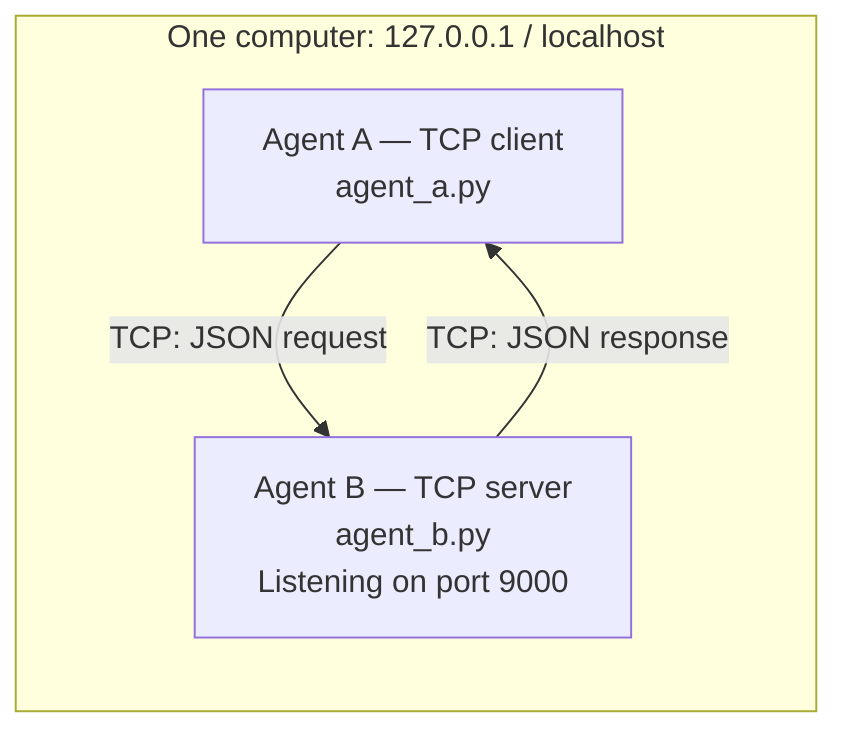

# Two-Agent TCP Calculator — From First Principles

A minimal Python client–server project demonstrating how two independent programs communicate over **TCP sockets**, exchange **JSON** messages, and handle application-level errors.

- **Agent A** is the **TCP client**: it sends an arithmetic request and prints the server's response.
- **Agent B** is the **TCP server**: it listens for connections, computes the requested operation, and sends back a JSON result.

Despite their names, these are **deterministic client/server programs**, not LLM-powered autonomous agents. The purpose is to learn the communication foundations of distributed and multi-agent systems **without FastAPI, Docker, or third-party Python packages**.

## Architecture



Both programs run as **separate Python processes** on the same computer. They do not import functions from each other: communication happens through a network socket. The loopback IP address `127.0.0.1` keeps the traffic on the local machine.

### Message exchange

```text
Agent A (client)                        Agent B (server)
       |                                       |
       |                              bind(127.0.0.1, 9000)
       |                                    listen(5)
       |                                       |
       |------------ TCP connect ------------>|
       |                                    accept()
       |                                       |
       |----- JSON request as UTF-8 bytes --->|
       |                         recv() → decode → json.loads()
       |                              operation(**data_obj)
       |                                       |
       |<---- JSON response as UTF-8 bytes ----|
       | recv() → decode → json.loads()        |
       |                                       |
       | close()                      with conn: closes socket
```

## Project structure

```text
tcp-calculator/
├── agent_a.py     # Client: sends the calculation request
├── agent_b.py     # Server: receives requests and computes results
└── README.md      # This documentation
```

## Requirements

- Python 3.9+ (standard library only: `socket` and `json`)
- Two terminal windows
- Local TCP port `9000` available

No virtual environment or `pip install` is necessary for this project.

## Source code

### `agent_b.py` — Server

```python
# agent B is the server (always listen to the upcoming requests)

import socket
import json

def operation(x: float, y: float, op: str) -> float:
    if op == "ADD":
        return x + y
    elif op == "SUBTRACT":
        return x - y
    elif op == "MULTIPLY":
        return x * y
    elif op == "DIVISION":
        if y == 0:
            raise ValueError("Denominator in division is zero")
        return x / y
    else:
        raise ValueError(f"The operation {op} is not supported")

server=socket.socket(socket.AF_INET, socket.SOCK_STREAM) #socket.SOCK_STREAM=TCP connection

server.bind(("127.0.0.1", 9000)) #server listen from the address 127.0.0.1 on port 9000

server.listen(5) #listen to upcoming 5 requests at most

while True:
    conn, addr = server.accept()
    print("Agent A is Connected Now...", addr)

    with conn:

        data = conn.recv(1024) #reciev up to 1024 bytes from client/Byte

        data_decode=data.decode()

        data_obj=json.loads(data_decode)

        try:
            result=operation(**data_obj)
            out_succs={"status":"success", "message": result}
            conn.sendall(json.dumps(out_succs).encode())
        except ValueError as e:
            out_err={"status": "error", "message": str(e)}
            json_string=json.dumps(out_err).encode()

            conn.sendall(json_string)
```

**Execution, step by step:**

1. `socket.socket(socket.AF_INET, socket.SOCK_STREAM)` creates an **IPv4 TCP socket**. `AF_INET` selects IPv4 and `SOCK_STREAM` selects TCP.
2. `bind(("127.0.0.1", 9000))` assigns the server a local listening address and port. `127.0.0.1` means *this computer*.
3. `listen(5)` marks the socket as listening. The `5` is the requested **backlog of pending connections**, **not** a maximum of five requests.
4. `while True` keeps the server accepting new connections; `accept()` waits until a client connects, then returns a new connected socket `conn` and the client's address `addr`.
5. `with conn:` closes that **accepted connection** when its block finishes. The original listening socket stays open.
6. `recv(1024)` reads **up to 1,024 bytes** from the connected TCP stream.
7. `data.decode()` converts the received bytes into a string (UTF-8 by default); `json.loads()` converts the JSON string into a Python object (a dictionary for this request).
8. `operation(**data_obj)` unpacks dictionary keys into named function arguments. For `{"x":5,"y":70,"op":"MULTIPLY"}`, it is equivalent to `operation(x=5, y=70, op="MULTIPLY")`.
9. For a valid operation, the function returns a number. The server wraps it in a dictionary, serializes it using `json.dumps()`, converts it to bytes with `.encode()`, and sends it with `sendall()`.
10. If `operation()` raises `ValueError` (division by zero or unsupported operation), the `except` branch sends an error dictionary instead. This error handling covers **the arithmetic operation**, not every possible parsing or networking error.

### `agent_a.py` — Client

```python
# agent A is a TCP client (send resuest to agent B)

import socket
import json

client=socket.socket(socket.AF_INET, socket.SOCK_STREAM) #TCP connection

client.connect(("127.0.0.1", 9000)) #connect to the server

input_data={"x":5, "y":70, "op":"MULTIPLY"}

input_json=json.dumps(input_data)

client.sendall(input_json.encode())
print('Agent A just sent the request')
print("...........")
respond_data=client.recv(1024)
respond=json.loads(respond_data.decode())
print("The result from server is: ", respond)

client.close()
```

**Execution, step by step:**

1. Create a TCP socket with the same address family and socket type as the server.
2. `connect(("127.0.0.1", 9000))` asks the OS to establish a TCP connection to Agent B's listening endpoint.
3. Create a Python dictionary representing the calculation.
4. `json.dumps(input_data)` turns the dictionary into JSON text.
5. `.encode()` converts the text to bytes; `sendall()` attempts to send all of those bytes to the server.
6. `recv(1024)` receives up to 1,024 response bytes. `.decode()` converts them to text and `json.loads()` converts that text back into a Python dictionary.
7. Print the result and close the client socket with `client.close()`.

## Running the project

**Terminal 1 — start the server first:**

```bash
python agent_b.py
```

The server waits at `accept()` until a client connects. It stays running to accept additional connections sequentially. Stop it with **Ctrl+C**.

**Terminal 2 — run the client:**

```bash
python agent_a.py
```

With the provided input, the expected client output is similar to:

```text
Agent A just sent the request
...........
The result from server is:  {'status': 'success', 'message': 350}
```

The server logs something like:

```text
Agent A is Connected Now... ('127.0.0.1', 54321)
```

The second port shown in the server log is an **ephemeral client-side port** selected by the OS; it will vary.

### Example: Division by zero

Change the client request to:

```python
input_data = {"x": 5, "y": 0, "op": "DIVISION"}
```

Expected response:

```json
{"status": "error", "message": "Denominator in division is zero"}
```

### Example: Unsupported operation

```python
input_data = {"x": 5, "y": 70, "op": "POWER"}
```

Expected response:

```json
{"status": "error", "message": "The operation POWER is not supported"}
```

## Core concepts explained

| Concept | Definition | In this project |
|---|---|---|
| **Process** | A running instance of a program, with its own execution context | Agent A and Agent B run as separate Python processes |
| **Client** | A process that initiates a connection/request | Agent A calls `connect()` and sends input |
| **Server** | A process that listens and responds to requests | Agent B calls `bind()`, `listen()`, and `accept()` |
| **IP address** | A network-layer address used to reach a network interface | `127.0.0.1` is the loopback address of the local machine |
| **Port** | A transport-layer number identifying a communication endpoint | Agent B listens on TCP port `9000` |
| **Socket** | An OS-provided endpoint used by programs for network I/O | Both agents use Python's `socket` module |
| **TCP** | A reliable, ordered **byte-stream** transport protocol | Carries bytes between the two processes |
| **JSON** | A text format for structured data exchange | Represents requests and responses |
| **Serialization** | Converting a Python object into a transmissible representation | `json.dumps()` produces JSON text |
| **Deserialization** | Reconstructing a Python object from a received representation | `json.loads()` parses JSON text |
| **Encoding** | Converting text to bytes | `.encode()` before sending |
| **Decoding** | Converting bytes to text | `.decode()` after receiving |

### Why both `json.dumps()` and `.encode()`?

A Python dictionary cannot be sent directly through a TCP socket:

```text
Python dict
   ↓ json.dumps()
JSON string
   ↓ .encode()
Bytes
   ↓ TCP socket
Network
   ↓ .decode()
JSON string
   ↓ json.loads()
Python dict
```

In the supplied implementation, the result is transmitted using the same mechanism in the reverse direction.

### What does `sendall()` guarantee?

`sendall()` repeatedly calls the socket's send operation until the supplied data has been handed to the local socket stack or an error occurs. It does **not** guarantee that the receiving application has processed the message successfully.

### Does `listen(5)` mean five clients maximum?

No. The backlog applies to **pending connections waiting to be accepted**. The server uses an infinite loop and can accept many connections over time, but the current server **handles only one connection at a time** and serves one request per accepted connection.

## Current limitations (intentional for a learning exercise)

This implementation is a good **small, local demonstration**, but it is not yet a general-purpose or production-ready TCP protocol.

1. **No message framing.** TCP delivers a stream of bytes, not complete JSON messages. One call to `recv(1024)` is **not guaranteed** to return a full JSON request/response. A message could be split across several reads. A robust implementation needs framing, such as newline-delimited JSON or length-prefixed messages.
2. **1,024-byte read limit.** Requests or responses larger than 1,024 bytes may be truncated by a single `recv()`.
3. **Sequential server.** The server processes one connection at a time, without threads, processes, or asynchronous I/O.
4. **One request per connection.** The client connects, sends one message, receives one response, and closes. Reusing the same connection for multiple requests would require an explicit protocol and a reading loop.
5. **Incomplete input-error handling.** Malformed JSON (`JSONDecodeError`), missing or unexpected fields (`TypeError`), and connection failures can terminate the current server, because the `try` block only handles `ValueError` arising during `operation()`.
6. **No network timeouts.** An unresponsive client can leave the server waiting indefinitely.
7. **Loopback only.** `127.0.0.1` means the server is reachable only from the same machine, not another physical computer.
8. **No authentication or transport encryption.** Suitable for a local exercise, not for accepting untrusted connections over a network.
9. **Fixed client input.** The provided client sends one hardcoded calculation per run; an interactive input loop would be a separate extension.

## What to learn next

Starting from this exact project, a useful learning progression is:

1. Add **message framing** (for example, newline-delimited JSON) and a receive loop.
2. Add **timeouts**, malformed-message handling, and a consistent response schema.
3. Support **multiple concurrent clients** using threads or `asyncio`.
4. Rebuild the same functionality with **HTTP + FastAPI**, seeing how the framework supplies standard request/response conventions.
5. Package each service into a **Docker image** and connect them using **Docker Compose**.
6. Add tools, agent state, and a configurable execution loop once the communication layer is understood.

The key first-principles insight is that **independent processes cannot call each other's live functions through a simple local import**. They need an explicit communication mechanism. In this project, that mechanism is **TCP plus a small, JSON-based request/response convention**.
