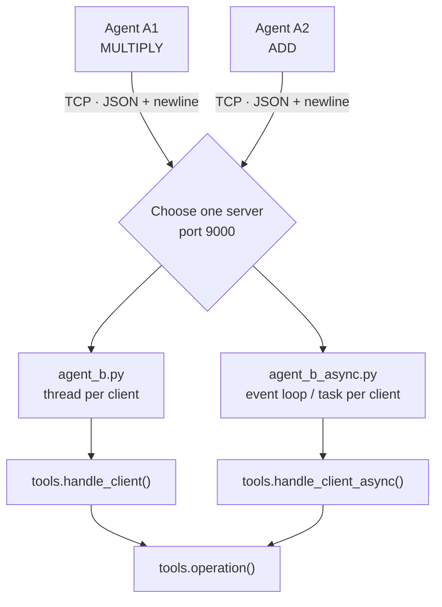

# V3 — Concurrent TCP Agents: Threading vs Asyncio

V3 extends V2's **newline-delimited JSON over TCP** to support multiple independent clients. It contains **two server implementations** of the same calculator protocol: one using Python threads, the other using `asyncio`. Both reuse the handlers and arithmetic operations in `tools.py`.

## Architecture



**Only one server runs at a time**, because both listen on `127.0.0.1:9000`. Both return a JSON response followed by `\n` on the same client connection.

## Files

```text
agentic-framework-v3/
├── agent_a1.py         # Client 1: MULTIPLY (5 × 70)
├── agent_a2.py         # Client 2: ADD (5 + 70)
├── agent_b.py          # Threaded server: threading.Thread per connection
├── agent_b_async.py    # Async server: asyncio.start_server()
├── tools.py            # operation(), handle_client(), handle_client_async()
└── README.md
```

## How it works

1. **Agent A1** and **Agent A2** establish independent TCP connections and send JSON requests terminated with `\n`.
2. **Threaded server:** `agent_b.py` accepts connections and starts a thread running `handle_client(conn, addr)` from `tools.py`. The handler collects bytes until `\n`.
3. **Async server:** `agent_b_async.py` uses `asyncio.start_server(handle_client_async, ...)`. The coroutine in `tools.py` receives data using `await reader.readline()`; while awaiting I/O, the event loop can run other client tasks.
4. Both handlers decode JSON, call the shared `operation()` function, and return newline-terminated JSON.

Example responses:

```json
{"status": "success", "message": 350}
```

```json
{"status": "success", "message": 75}
```

## Run

**Option A — multithreaded server:**

```bash
python agent_b.py
```

**Option B — asyncio server (stop Option A first):**

```bash
python agent_b_async.py
```

In another terminal, launch both existing clients together (macOS/Linux):

```bash
python agent_a1.py & python agent_a2.py & wait
```

To visualize overlapping work, put `time.sleep(5)` in the threaded handler or `await asyncio.sleep(5)` in the async handler **before** `operation()`. Two near-simultaneous requests should complete in about **5 seconds total**, not 10. Remove the delay after testing.

## Threading vs Asyncio

| Threading (`agent_b.py`) | Asyncio (`agent_b_async.py`) |
|---|---|
| One OS thread per client | One event-loop task per client |
| `conn.recv()` blocks that client thread | `await reader.readline()` suspends that task |
| `conn.sendall()` | `writer.write()` + `await writer.drain()` |
| `time.sleep(5)` delays only its thread | `await asyncio.sleep(5)` lets other tasks run |

**Key idea:** Both approaches handle overlapping I/O. Neither automatically makes CPU-heavy Python calculations parallel.

**Current limitations:** One request per connection; no connection timeout, maximum message-size limit, or graceful shutdown logic. The threaded server also creates an unbounded number of threads. These are educational examples, not production servers.
