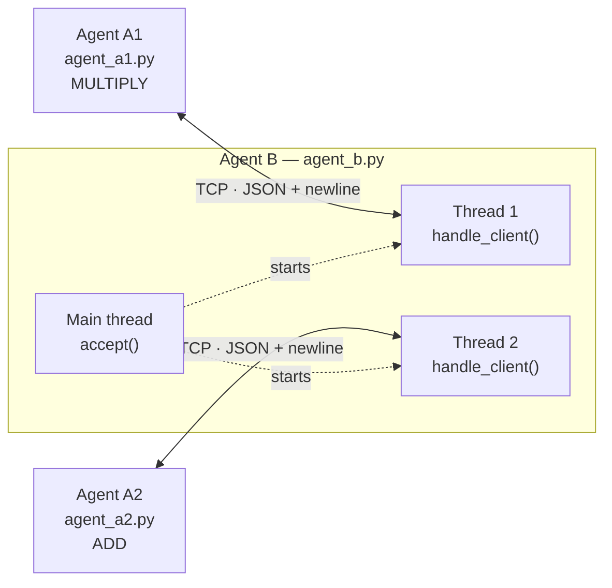

# V3 — Concurrent TCP Agents with Python Threads

V3 extends the newline-delimited JSON protocol from V2 so **Agent B can serve multiple independent clients at the same time**. Each incoming TCP connection gets its own thread.

## Architecture



## How it works

1. **Agent B** listens on `127.0.0.1:9000` and accepts TCP connections.
2. For each connection, `threading.Thread(target=handle_client, args=(conn, addr)).start()` launches a handler.
3. The handler accumulates bytes until `\n`, then decodes JSON and calls `operation()` from `tools.py`.
4. It sends a JSON result followed by `\n` and closes that client connection.
5. **Agent A1** requests `MULTIPLY` (`5 × 70`); **Agent A2** requests `ADD` (`5 + 70`). They run as separate processes with separate sockets.

**Example responses**

```json
{"status": "success", "message": 350}
```

```json
{"status": "success", "message": 75}
```

## Files

```text
agentic-framework-v3/
├── agent_a1.py   # Client 1: MULTIPLY
├── agent_a2.py   # Client 2: ADD
├── agent_b.py    # TCP server: accept connections and start threads
├── tools.py      # operation() and handle_client()
└── README.md
```

## Run

Start the server in one terminal:

```bash
python agent_b.py
```

From another terminal, launch both clients **at nearly the same time** (macOS/Linux):

```bash
python agent_a1.py & python agent_a2.py & wait
```

To observe concurrency, temporarily add `time.sleep(5)` inside `handle_client()` before executing the operation. Two requests should finish in **about 5 seconds total**, rather than 10 seconds when processed sequentially.

## What V3 demonstrates

- **Concurrency:** a waiting client does not prevent another thread from being handled.
- **Isolation:** each client has its own connection; each server handler closes its socket with `with conn:`.
- **Framing:** TCP is a byte stream, so `\n` marks the end of each JSON message.

**Limitations:** This version creates an unbounded thread per connection, has no connection timeout or message-size limit, and handles one request per connection. The clients should read the newline-terminated response with `readline()`, not assume a single `recv()` is complete.

**Next:** V4 — replace per-client threads with `asyncio` and an event loop.
