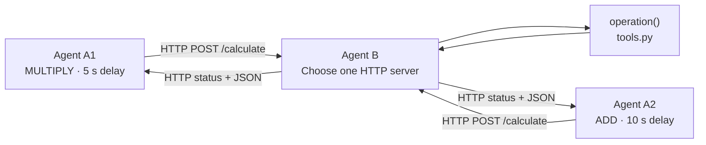

# V4 — HTTP Agent Communication: Sequential, Threaded, and Async

V4 replaces the custom **JSON-over-TCP** protocol from V1–V3 with **HTTP**. We keep the same calculator and two independent clients, then implement Agent B in three ways to understand what an HTTP framework adds and how concurrency works.

## Architecture



All three servers expose **`POST http://127.0.0.1:8000/calculate`**. Run **only one server at a time**, because they use the same port. The clients use `requests.post(url, json=input_data)`, which serializes the dictionary, sends an HTTP request, and exposes the response through `response.status_code` and `response.json()`.

## Project structure

```text
agentic-framework-v4/
├── agent_a1.py             # HTTP client A1: MULTIPLY (5 s)
├── agent_a2.py             # HTTP client A2: ADD (10 s)
├── agent_b.py              # Sequential HTTPServer
├── agent_b_concurrent.py   # ThreadingHTTPServer
├── agent_b_async.py        # FastAPI application served by Uvicorn
├── tools.py                # Shared operation(x, y, op)
└── README.md
```

## Why HTTP instead of raw TCP?

TCP transports a **stream of bytes**, not complete application messages. In V2–V3, we defined our own message boundary (`\n`), decoded the bytes, parsed JSON, and managed request/response behavior.

HTTP is an **application-layer protocol**, typically carried over TCP. It standardizes methods (`GET`, `POST`), paths (`/calculate`), headers (`Content-Type`, `Content-Length`), status codes (`200`, `400`, `404`), and message bodies. HTTP does *not* eliminate TCP; it gives both services an agreed protocol above TCP.

Example request:

```http
POST /calculate HTTP/1.1
Host: 127.0.0.1:8000
Content-Type: application/json

{"x":5,"y":7,"op":"MULTIPLY","agent":"A1"}
```

The actual HTTP client also supplies the necessary body framing (for example, `Content-Length`). A successful response contains status **200** and a JSON body:

```json
{"status":"success","message":35}
```

The `agent` field is used **only to simulate latency**: A1 waits 5 seconds; A2 waits 10 seconds. Remove or exclude it before calling the shared `operation(x, y, op)` function. These are calculator clients for demonstrating communication, not yet autonomous LLM agents.

## Three implementations of Agent B

| Feature | `HTTPServer` | `ThreadingHTTPServer` | FastAPI + Uvicorn |
|---|---|---|---|
| File | `agent_b.py` | `agent_b_concurrent.py` | `agent_b_async.py` |
| Request handler | `BaseHTTPRequestHandler.do_POST()` | Same `do_POST()` | `@app.post("/calculate")` |
| Concurrency | One request at a time | A thread per connection | Async tasks on an event loop |
| Read JSON | Manually: `rfile.read()` + `json.loads()` | Same manual parsing | FastAPI parses request body |
| Build response | Status, headers, and bytes manually | Same | Return a Python object |
| Validate fields | Write checks yourself | Write checks yourself | Pydantic model validation |
| Simulated delay | `time.sleep(...)` | `time.sleep(...)` | `await asyncio.sleep(...)` |

### 1. Sequential — `HTTPServer`

`HTTPServer` is built on Python's `socketserver.TCPServer`: it accepts TCP connections and creates request handlers. Your `do_POST()` reads `Content-Length`, reads the body from `self.rfile`, calls `operation()`, and sends status/headers/body using `self.send_response()`, `self.send_header()`, and `self.wfile.write()`.

Because this server handles requests **sequentially**, A2's 10-second wait cannot overlap A1's 5-second wait. Two near-simultaneous requests take approximately **15 seconds in total**.

### 2. Threaded — `ThreadingHTTPServer`

This changes the **server's concurrency model**, not the HTTP protocol or calculator logic. Python runs each accepted connection's handler in its own thread. While one handler is inside `time.sleep()`, another thread can process the other client. The delays overlap, so the combined run takes approximately **10 seconds**. A thread-per-connection design can consume significant resources at large scale.

### 3. Asynchronous — FastAPI + Uvicorn

These are two separate components:

- **FastAPI** defines the application: routes, input models, validation, endpoint logic, and JSON responses.
- **Uvicorn** is the ASGI server: it accepts HTTP traffic and drives the asynchronous application with an event loop.

For example, FastAPI replaces manual `do_POST()` routing and response construction with:

```python
@app.post("/calculate")
async def calculate(data: CalculationRequestBody):
    # Validate input, await the simulated delay, call operation()
    return {"status": "success", "message": result}
```

At `await asyncio.sleep(5)` or `await asyncio.sleep(10)`, a coroutine **yields control** so the event loop can work on the other request. No separate OS thread is needed *per request* for this async waiting. Both delays overlap, again giving approximately **10 seconds total**.

**Important:** `async def` is not automatic parallelism. A blocking `time.sleep()` or expensive synchronous CPU calculation inside the async endpoint will block the event-loop thread. Use `await` with genuinely asynchronous I/O; CPU-heavy work needs a separate execution strategy.

## Why Pydantic?

With `http.server`, request data was a raw dictionary and you were responsible for checking that fields exist and have the right types. FastAPI integrates **Pydantic** to define an explicit input *schema*:

```python
from pydantic import BaseModel

class CalculationRequestBody(BaseModel):
    x: float
    y: float
    op: str
    agent: str
```

Then:

```python
@app.post("/calculate")
async def calculate(data: CalculationRequestBody):
    result = operation(data.x, data.y, data.op)
    return {"status": "success", "message": result}
```

Pydantic checks required fields and types **before your endpoint runs**. It can coerce compatible values (for example, an integer to a float); unsuitable inputs receive a validation error. It also gives you named attributes (`data.x`) instead of unvalidated dictionary access (`data["x"]`), and FastAPI uses the schema to generate API documentation at **`/docs`**.

Pydantic validates **structure and types**, not every business rule. For instance, `op: str` accepts `"ADDITION"` as a string. Your calculator still decides that the operation is unsupported; raise `HTTPException(status_code=400, detail=str(e))` for that domain error.

| Case | Typical FastAPI result |
|---|---|
| Correct request | **200 OK** + result JSON |
| `"op": "ADDITION"` | **400 Bad Request** from your `HTTPException` |
| Missing `op` or non-numeric `x` | **422 Unprocessable Content** from validation |
| Wrong endpoint | **404 Not Found** |

In short: **HTTP is the protocol, Uvicorn is the async server, FastAPI is the web framework, and Pydantic validates the data.** They solve different problems.

## Install and run

From the repository root, create or activate your shared virtual environment:

```bash
python3 -m venv .venv       # only once
source .venv/bin/activate  # macOS / Linux
pip install requests fastapi uvicorn
```

From `agentic-framework-v4/`, start **one** Agent B implementation:

```bash
python agent_b.py             # Sequential
# OR
python agent_b_concurrent.py  # Threaded
# OR
uvicorn agent_b_async:app --host 127.0.0.1 --port 8000  # Async
```

In another terminal, launch the two **unchanged** HTTP clients together and time the entire run:

```bash
time (python agent_a1.py & python agent_a2.py & wait)
```

| Server | Expected combined wall-clock time |
|---|---:|
| Sequential `HTTPServer` | ~15 s |
| Threaded `ThreadingHTTPServer` | ~10 s |
| Async FastAPI + Uvicorn | ~10 s |

Read the shell's **`real`** value. These are illustrative timings for two nearly simultaneous requests with artificial delays, not throughput benchmarks; process startup and overhead introduce small differences. For FastAPI, the interactive API documentation is at **http://127.0.0.1:8000/docs** while Uvicorn is running.

## Key lessons and limitations

- The **same clients and HTTP contract** can work with different server implementations.
- Threading overlaps blocking I/O by scheduling multiple threads; `asyncio` overlaps cooperative, non-blocking tasks via `await`.
- Pydantic provides a schema and automatic request validation; business errors still need application handling.
- These examples are **local, educational services**. The standard-library `http.server` is not production-hardened; robust deployments need appropriate timeouts, request-size limits, operational safeguards, and security controls.

**Next:** Deploy separate agent services and make them communicate across service boundaries (then Docker and service discovery).
