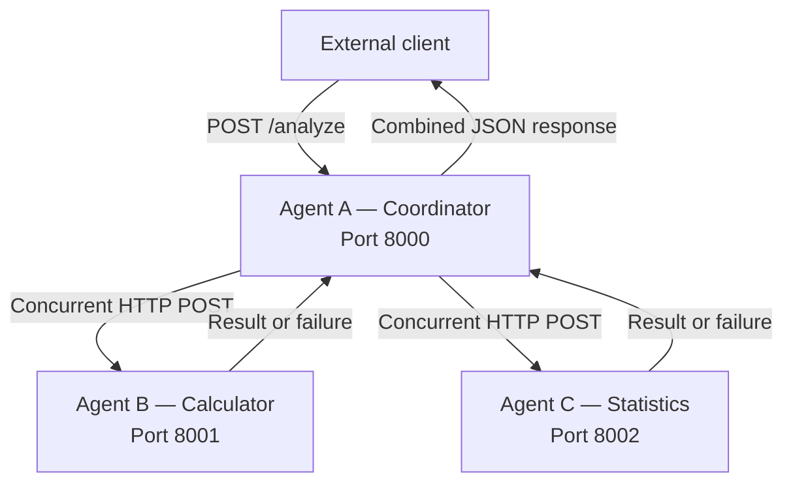

# V5 — Distributed Agent Communication and Resilience

V5 extends the earlier TCP and HTTP examples into **three independent FastAPI services**. Agent A is a coordinator: it receives an external request, delegates work to specialist services over HTTP, and combines their results. Along the way, this version explores retries, timeouts, concurrent requests, and partial failures.

> These are **distributed services**, not yet autonomous LLM agents. Agent A follows a predefined workflow; planning and tool selection come in later versions.

## Architecture



Agent B performs arithmetic such as `MULTIPLY`; Agent C computes statistics such as the mean of `x` and `y`. **Each service runs in its own process** and can fail independently.

## Project structure

```text
agentic-framework-v5/
├── agent_a.py             # Simple concurrent coordinator: /analyze
├── agent_a_retry.py       # Earlier coordinator illustrating retry logic
├── agent_a_resilient.py   # Concurrent delegation + retries + partial results
├── agent_b.py             # Calculator API: POST /calculate
├── agent_c.py             # Statistics API: POST /statistics
├── tools.py               # Arithmetic operation() function
├── .env                   # Local service URLs (not committed)
└── README.md
```

The coordinator files capture different **learning stages**. Keep the simpler versions for comparison; start only one Agent A server at a time because they share port `8000`. Depending on your saved implementation, `agent_a_retry.py` may expose `/task` while the concurrent variants expose `/analyze`.

## Key concepts, from first principles

### 1. Service-to-service HTTP

In V4, standalone client scripts sent HTTP requests to a server. Here, **Agent A is itself an HTTP server and HTTP client**: FastAPI accepts a request, and `httpx.AsyncClient` sends requests to Agent B and Agent C. Each specialist has its own URL and port.

- **FastAPI** defines routes and returns JSON responses.
- **Uvicorn** runs each FastAPI application as an HTTP server.
- **Pydantic** validates incoming fields (`x: float`, `y: float`, `op: str`) before the endpoint runs.
- **HTTPX** sends outbound HTTP requests; `await` permits other work while waiting for network I/O.

### 2. Concurrent delegation with `asyncio.gather()`

Agent A can start both specialist requests without waiting for one to finish before starting the other:

```python
response_b, response_c = await asyncio.gather(
    client.post(agent_b_url, json=data_b),
    client.post(agent_c_url, json=data_c),
    return_exceptions=True
)
```

Agent B receives `{ "x", "y", "op" }`; Agent C receives only `{ "x", "y" }`. With independent slow operations, concurrent elapsed time is approximately the **longer** of the two, rather than their sum.

### 3. Timeouts and HTTP errors

Network calls are not guaranteed to succeed:

| Failure | Meaning | Example coordinator handling |
|---|---|---|
| `httpx.ConnectError` | Could not connect to a specialist | Retry; report unavailable if exhausted |
| `httpx.TimeoutException` | A network operation took too long | Report timeout for that specialist |
| HTTP `400` | Specialist rejected an invalid request | Preserve its error; do not retry |
| HTTP `500` | Specialist encountered an internal error | Report failure without hiding other results |

`httpx.AsyncClient(timeout=15.0)` sets HTTPX network-operation timeouts; it does **not** necessarily enforce a single 15-second deadline for all retries combined.

### 4. Retry with exponential backoff

The resilient coordinator retries **connection failures only**, up to **three total attempts**. Between attempts it waits 1 second, then 2 seconds:

```python
for attempt in range(3):
    try:
        return await client.post(url, json=data)
    except httpx.ConnectError as error:
        if attempt == 2:
            return error
        await asyncio.sleep(2 ** attempt)
```

`asyncio.sleep()` does not block the event loop. We intentionally **do not automatically retry read timeouts**: an operation may have succeeded remotely even when its response was lost, and retrying could repeat a side effect.

### 5. Partial failure and graceful degradation

`asyncio.gather(..., return_exceptions=True)` lets Agent A collect an exception as a result rather than immediately failing the entire endpoint. Each response is processed separately:

- Successful HTTP response → deserialize JSON.
- HTTP error response → record status code and error body.
- Network exception → record exception type and message.

This means **Agent B can succeed even when Agent C is offline**. Note that `return_exceptions=True` collects failures; it does not itself retry requests.

## Setup and run

From the repository root, activate your existing virtual environment, or create one if necessary:

```bash
source .venv/bin/activate
pip install fastapi uvicorn httpx python-dotenv
```

Create `agentic-framework-v5/.env`:

```dotenv
AGENT_B_URL=http://127.0.0.1:8001/calculate
AGENT_C_URL=http://127.0.0.1:8002/statistics
```

**Do not commit `.env`**; add `.env` to the repository's root `.gitignore`. Run the following commands **from the `agentic-framework-v5` directory**, in separate terminals:

```bash
uvicorn agent_b:app --port 8001 --reload
```

```bash
uvicorn agent_c:app --port 8002 --reload
```

```bash
uvicorn agent_a_resilient:app --port 8000 --reload
```

Only one coordinator variant should listen on port 8000 at a time. For comparison, stop the resilient coordinator and run `uvicorn agent_a:app --port 8000 --reload` instead.

## Test the system

```bash
curl -X POST http://127.0.0.1:8000/analyze \
  -H "Content-Type: application/json" \
  -d '{"x":5,"y":7,"op":"MULTIPLY"}'
```

When both specialists are available, the expected response is:

```json
{
  "calculation": {"status": "success", "message": 35.0},
  "statistics": {"status": "success", "mean": 6.0}
}
```

To verify resilience, **stop Agent C only**, leaving Agent A and Agent B running. Repeat the request. Agent A should return the successful calculation together with a structured error for statistics. With immediate connection refusal, Agent C's three attempts include approximately **3 seconds** of backoff. Try stopping B, then both specialists, to confirm that their failures remain independent.

If a test unexpectedly produces HTTP `500`, inspect the **Agent A terminal traceback**. Verify that `data_c` is created before `asyncio.gather()` and that both URLs in `.env` point to the intended services.

## Current limitations and next direction

This version uses fixed service URLs, simple retry rules, and in-memory request handling. It has no service registry, persistent task state, authentication, rate limiting, distributed tracing, or idempotency keys. Partial failures are returned as per-agent results rather than an overall task status.

**Next:** Add **agent registration and discovery**, so Agent A selects a specialist using a registry instead of embedding individual service URLs in its orchestration logic.
