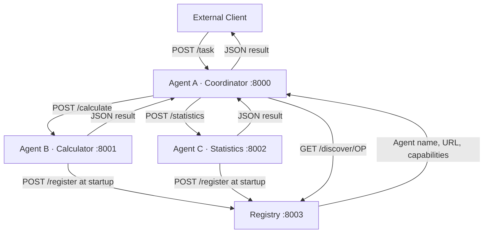

# V6 — Agent Registry, Self-Registration & Dynamic Routing

V6 extends the distributed HTTP services built in V5. Rather than hardcoding Agent B's and Agent C's URLs inside the coordinator, **Agent A discovers a specialist by capability through a registry**.

## Architecture



## Project files

```text
agentic-framework-v6/
├── agent_a.py     # Coordinator: discover capability, invoke specialist
├── agent_b.py     # Calculator: ADD, SUBTRACT, MULTIPLY, DIVISION
├── agent_c.py     # Statistics: MEAN, MAX
├── registry.py    # In-memory registration and discovery service
├── tools.py       # Shared calculation function
└── README.md
```

## What each component does

- **Registry (`:8003`)** stores registrations in an in-memory dictionary keyed by agent name. `POST /register` inserts or updates an entry; `GET /agents` lists entries; `GET /discover/{capability}` returns the first matching entry, or HTTP `404` when none matches.
- **Agent B (`:8001`)** exposes `POST /calculate` and declares its calculator capabilities.
- **Agent C (`:8002`)** exposes `POST /statistics` and declares `MEAN` and `MAX`. Both specialists accept `x`, `y`, and `op`.
- **Agent A (`:8000`)** exposes `POST /task`. It asks the registry which agent supports `op`, reads that agent's URL, forwards the JSON request using `httpx.AsyncClient`, and returns the specialist's JSON response.

### Why self-registration?

In the first version of V6, we used manual `curl` requests to populate the registry. That works, but the caller could claim any capabilities, regardless of what an agent implements.

With FastAPI's **`lifespan`** hook, each specialist sends its own name, endpoint URL, and declared capabilities to `POST /register` at startup. This removes the need for manual registration and keeps capability declarations close to the implementation. **It does not prove the claims are true**; authentication and verification are not implemented yet.

### Why dynamic discovery?

In V5, Agent A explicitly configured the URL of each specialist. In V6, it only needs to know the **registry URL**. It can route `MULTIPLY` to the calculator and `MAX` to the statistics agent without embedding either service URL in its routing logic.

## Start the services

Activate your repository's virtual environment, then start each server in a separate terminal, in this order:

```bash
# 1. Registry
uvicorn registry:app --port 8003 --reload

# 2. Specialists (each self-registers at startup)
uvicorn agent_b:app --port 8001 --reload
uvicorn agent_c:app --port 8002 --reload

# 3. Coordinator
uvicorn agent_a:app --port 8000 --reload
```

These commands are shown together for reference; **run each in its own terminal**. Start them from the `agentic-framework-v6` directory. If a specialist fails to register at startup, confirm the registry is already running.

## Test registration, discovery and routing

```bash
# List registered specialists
curl http://127.0.0.1:8003/agents

# Discover by capability
curl http://127.0.0.1:8003/discover/MULTIPLY
curl http://127.0.0.1:8003/discover/MAX

# Route to calculator via Agent A
curl -i -X POST http://127.0.0.1:8000/task \
  -H 'Content-Type: application/json' \
  -d '{"x":5,"y":7,"op":"MULTIPLY"}'

# Route to statistics via Agent A
curl -i -X POST http://127.0.0.1:8000/task \
  -H 'Content-Type: application/json' \
  -d '{"x":5,"y":7,"op":"MAX"}'

# Capability not registered: expected HTTP 404 from Agent A
curl -i -X POST http://127.0.0.1:8000/task \
  -H 'Content-Type: application/json' \
  -d '{"x":5,"y":7,"op":"ADDd"}'
```

Expected successful JSON results include `{"status":"success","message":35.0}` for multiplication (with the Agent B response format used in this project) and `{"max":7.0}` for maximum.

## Error handling

- **Unknown capability:** Registry returns `404`; Agent A translates the discovery `httpx.HTTPStatusError` into an HTTP `404` response.
- **Specialist rejects a request:** Agent A forwards the specialist's HTTP error status; the current implementation can place the upstream response text in the `detail` field.
- **Unreachable registry or specialist:** Not yet handled in V6; an uncaught HTTPX connection error can surface as an HTTP `500` from Agent A.

## Current limitations

- The registry is **in memory**: restarting it loses all registrations.
- Self-registration happens **only at specialist startup**; an agent does not automatically re-register if the registry restarts later.
- The registry doesn't remove entries when agents stop; discovery can return **stale URLs**.
- Capability declarations are **trusted**, not verified; there is no authentication.
- Discovery returns the first matching agent; no load balancing or health-based selection.
- This version deliberately leaves out V5's retries and partial-failure orchestration to focus on registration and discovery.

**Next: V7 — Agent Health, Deregistration & Heartbeats.** Learn how to detect stale registrations and prevent Agent A from routing tasks to agents that are no longer alive.
